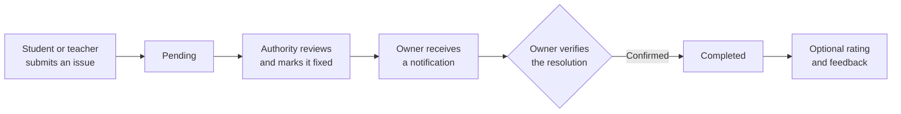

<div align="center">
  

  <br />

  <p><strong>A better campus starts when every voice is heard.</strong></p>
  <p>Report campus issues, support community priorities, and follow each resolution from submission to confirmation.</p>

  <p>
    
    
    
    
    
    
    
    
  </p>
  <p><a href="#getting-started">🚀 Get started</a> &nbsp;·&nbsp; <a href="#highlights">✨ Explore features</a> &nbsp;·&nbsp; <a href="#api-reference">📡 API reference</a></p>
</div>

---

## Overview

**UniVoice** is a full-stack campus complaint portal for students, teachers, university authorities, and administrators. It combines a responsive web interface with a REST API so campus issues can be submitted, prioritized, addressed, and verified in one place.

## ✨ Highlights

| 💬 Voice | 🗳️ Community | ✅ Resolution |
| --- | --- | --- |
| Students and teachers submit campus concerns with categories and details. | Vote on other users' concerns and help surface what needs attention. | Authorities record a fix; the original poster verifies the outcome. |

| 🔔 Stay informed | ⭐ Close the loop | 🛡️ Manage access |
| --- | --- | --- |
| In-app notifications keep complaint owners up to date. | Completed complaints can receive ratings and written feedback. | Admins manage user approval and create privileged accounts. |

<p align="center">
  
  
  
  
</p>

## 🔄 How a complaint gets resolved



## 🧰 Technology

| Layer | Technologies & libraries |
| --- | --- |
| 🟩 **Backend runtime** | Node.js · CommonJS modules |
| 🚀 **Server framework** | Express **5.3.0** |
| 🍃 **Database & ODM** | MongoDB · Mongoose **9.11.1** |
| 🔐 **Authentication & security** | JSON Web Tokens (`jsonwebtoken`) · `bcryptjs` password hashing (**12 salt rounds**) |
| 🖥️ **Frontend architecture** | Vanilla HTML5, CSS3, and JavaScript · Single-page application (SPA) |
| ✨ **Animations & typography** | GSAP **3.12.5** · ScrollTrigger · Google Fonts (**Outfit**, **Inter**) |

## 🚀 Getting started

<details>
<summary><strong>📋 Requirements</strong></summary>

- Node.js **20.19 or newer**
- npm
- MongoDB running locally, or a MongoDB Atlas connection string

</details>

### 📦 Install and configure

```bash
git clone <your-repository-url>
cd UniVoice
npm install
```

Create your local environment file from the example:

```powershell
Copy-Item .env.example .env
```

On macOS or Linux, use `cp .env.example .env` instead. Edit `.env` and set a strong, private `JWT_SECRET` and your MongoDB connection string:

```env
PORT=
MONGO_URI=
JWT_SECRET=
JWT_EXPIRE=
```

Start the app:

```bash
npm run dev
```

For a regular start without auto-reload:

```bash
npm start
```

Open **http://localhost:5000**. The health endpoint is **http://localhost:5000/api/health**.

> **Account setup:** students and teachers can register in the app. Authority and administrator accounts are created through the admin API, which requires an existing administrator account. This repository does not currently include a seed script or default login credentials.

## 👥 User roles

| Role | Main capabilities |
| --- | --- |
| 🧑‍🎓 **Student** | Register, submit complaints, vote on others' complaints, confirm a fix, and leave feedback |
| 🧑‍🏫 **Teacher** | Submit complaints, vote on others' complaints, confirm a fix, and leave feedback |
| 🏛️ **Authority** | Review complaints, mark them fixed with a note, and view complaint statistics |
| 🛡️ **Admin** | Manage user approval, create privileged accounts, and perform authority actions |

## 📡 API reference

All endpoints are prefixed with `/api`. Private endpoints require an access token in the `Authorization` header using the bearer-token scheme.

### 🔐 Authentication

| Method | Endpoint | Access |
| --- | --- | --- |
| `POST` | `/auth/register` | Public — student or teacher |
| `POST` | `/auth/login` | Public |
| `GET` | `/auth/me` | Authenticated |
| `GET` | `/auth/notifications` | Authenticated |
| `PUT` | `/auth/notifications/read` | Authenticated |

### 📝 Complaints

| Method | Endpoint | Access |
| --- | --- | --- |
| `GET` | `/complaints` | Authenticated; supports status, category, search, and pagination filters |
| `GET` | `/complaints/stats` | Authority, admin |
| `GET` | `/complaints/:id` | Authenticated |
| `POST` | `/complaints` | Student, teacher |
| `DELETE` | `/complaints/:id` | Complaint owner after completion, or admin |
| `POST` | `/complaints/:id/vote` | Student, teacher |
| `PATCH` | `/complaints/:id/mark-fixed` | Authority, admin |
| `PATCH` | `/complaints/:id/confirm-complete` | Complaint owner |
| `POST` | `/complaints/:id/feedback` | Complaint owner after completion |

### ⚙️ Administration

| Method | Endpoint | Access |
| --- | --- | --- |
| `GET` | `/admin/users` | Admin |
| `PATCH` | `/admin/users/:id/toggle-approval` | Admin |
| `POST` | `/admin/create-user` | Admin |

## 🗂️ Project layout

```text
UniVoice/
├── assets/
│   └── univoice-banner.svg       # Animated GitHub README header
├── config/
│   └── db.js                     # MongoDB connection
├── controllers/                  # Authentication and complaint logic
├── middleware/                   # JWT authorization and error handling
├── models/                       # User and complaint schemas
├── routes/                       # Authentication, complaint, and admin APIs
├── public/
│   ├── index.html                # Single-page application
│   ├── css/styles.css            # Responsive interface and animations
│   └── js/app.js                 # Client-side application
├── .env.example                  # Environment variable template
├── server.js                     # Express entry point
└── package.json
```

## 🧑‍💻 Development

```bash
npm run dev
```

The project currently has no automated test suite configured; `npm test` is a placeholder.

## 🔒 Security notes

- Keep `.env` and real database credentials private; never commit them.
- Use a unique, high-entropy `JWT_SECRET` outside local development.
- The included `.gitignore` excludes local JSON database files and environment secrets.

---

<div align="center">
  <h3>🌟 Report clearly · Track transparently · Improve together 🌟</h3>
  <sub>Built to turn campus feedback into meaningful action.</sub>
</div>
